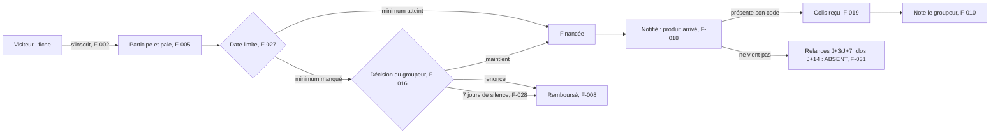
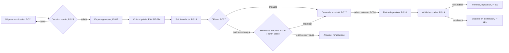

# Carte du projet

Établie par lecture de `CAHIER_DES_CHARGES.md`, `README.md`, `CLAUDE.md`, `mapper/` et du code (`backend/groupachat/api.py` pour les routes, `frontend/boutique/src/App.tsx` et `frontend/admin/src/App.tsx` pour les écrans, et chaque appel `api.get/post/patch/delete` rapproché de sa route). **« Constatée » veut dire « route et écran présents, et l'écran appelle une route qui existe »** : rien n'a été exécuté, c'est l'agent `recette` qui prouve que ça marche.

## Le projet en cinq lignes
Group Achat est une place de marché d'achat groupé pour Lomé, sur le web et pensée d'abord pour le téléphone : une boutique (`frontend/boutique/`) et une console d'administration (`frontend/admin/`), servies par une API Django (`backend/`).
Un **groupeur** dont l'identité est vérifiée (KYC) lance une campagne : un produit, un prix, un minimum de pièces et une date limite. Les **acheteurs** paient leur part, et l'argent reste **sous séquestre** pour chaque campagne. L'argent ne va jamais directement au groupeur.
À la date limite, la collecte se ferme. Si le minimum n'est pas atteint, le groupeur choisit de maintenir ou de renoncer. Sans réponse de sa part pendant 7 jours, chaque acheteur est remboursé.
Si la campagne est financée, le groupeur reçoit les fonds moins 1 500 FCFA, achète la marchandise et la met à disposition. Chaque acheteur la retire contre un **code unique / QR**, et la validation de ce code vaut preuve de livraison.
La plateforme met en relation sans arbitrer : une plainte se dit dans le fil public de la campagne et se traduit dans la note du groupeur. Les SMS et les paiements sont simulés, mais la comptabilité du séquestre est réelle.

## Rôles
| Rôle | Qui | Accès | Source |
|---|---|---|---|
| **Visiteur** | n'importe qui, sans compte | catalogue, fiche, fil (lecture), avis, réputation | §3 acheteur 1, §4 Inscription, §7 |
| **Acheteur** | compte dont le numéro est vérifié par SMS (simulé) | participer, payer, retirer, noter, écrire dans le fil, demander à devenir groupeur | §3, §5 |
| **Groupeur** | acheteur qui a déposé un dossier KYC **validé** par l'administrateur | espace groupeur (`/groupeur`) ; avant validation, seulement un écran d'attente | §3, §5 |
| **Administrateur** | compte interne (`est_equipe`) | console séparée (`admin.achatgr.com`, port 5174) | §3, §5 |
| **Système** | la tâche horaire `cloturer_les_campagnes_echues` et les contraintes en base | clôture à la date limite, remboursement après 7 jours sans décision, plafonds du séquestre | §4, §9, `COOLIFY.md` §4 |

## Visiteur — aboutissements
| Aboutissement | Parcours (étapes) | Fonctionnalités |
|---|---|---|
| Il a trouvé une campagne et jugé s'il peut faire confiance au groupeur | Accueil (fil vertical) ou Catalogue (rayons, recherche, tri) → fiche campagne (photos, jauge, paliers, point de remise) → réputation du groupeur et avis → fil de discussion en lecture | F-001, F-004, F-021, F-009 (lecture) |
| Il a un compte vérifié, prêt à commander | Fiche → « Participer » → feuille « créez votre compte » → Inscription (nom, prénom, téléphone, mot de passe, e-mail facultatif) → code affiché à l'écran → vérification, qui ouvre aussi la session | F-002 |

Constat de parcours : après la vérification, l'écran renvoie vers l'accueil (`naviguer("/")`, `Authentification.tsx`) et non vers la campagne d'où venait le visiteur. Il doit la retrouver lui-même. Ce n'est pas un trou de la carte, mais une étape en plus.

## Acheteur — aboutissements
| Aboutissement | Parcours (étapes) | Fonctionnalités |
|---|---|---|
| **Sa part est payée et consignée, et il a son code** | Fiche → Participer (quantité, opérateur TMoney / Flooz) → paiement simulé → « Votre part est consignée » + code → « Voir mon QR code » | F-005, F-006, F-008 |
| **Il a reçu son colis** | Notification « Votre produit est arrivé » (point de remise + code) → Mes achats → détail (QR) → il présente le code au point de retrait → notification « Retrait confirmé » | F-008, F-006 ; côté groupeur F-018, F-019 |
| Il a donné son avis sur le groupeur | Mes achats → détail → formulaire d'avis, ouvert dès que la collecte est close | F-010 |
| Il a obtenu une réponse à sa question | Fiche → fil → écrire ou répondre → notification « Réponse à votre message » | F-009, F-008 |
| Il retrouve une campagne sortie du catalogue | Mes achats → lien vers la fiche, ouverte même si la campagne est annulée ou n'a pas atteint son minimum | F-007 |
| Il a déposé son dossier pour devenir groupeur | Profil → « Devenir groupeur » → formulaire KYC | F-011 |
| *Échec* — **groupage non abouti, puis maintenu** | Notification « Le groupage n'a pas abouti » → part consignée → notification « Le groupage est maintenu » → suite normale | F-027, F-016, F-008 |
| *Échec* — **groupage annulé : il est remboursé intégralement, sans rien demander** | Groupeur qui renonce (F-016) **ou** 7 jours sans décision (F-028) → notifications « Groupage annulé » et « Remboursement effectué » | F-016, F-028, F-008 |
| *Échec* — **colis non retiré** : relancé à J+3 et J+7, livraison réputée acquise à J+14 | — **aucun chemin** : ni relance, ni clôture | F-031 |
| *Échec* — produit décevant : il le dit publiquement et note le groupeur | Fil + avis ; la plateforme n'arbitre pas (§2) | F-009, F-010 |
| *Échec* — le groupeur a touché les fonds et ne livre pas | — **aucun chemin** au-delà de l'avis : aucun remboursement n'est possible une fois les fonds libérés (voir Q4) | — |
| *Échec* — paiement refusé par l'opérateur | — **aucun chemin** : la part reste « en attente de paiement », et elle bloque toute nouvelle participation à la même campagne (`CreationParticipationSerialiseur`). Aucun écran ne permet de la payer à nouveau ni de l'abandonner. Cela n'arrive pas avec le paiement simulé (voir Q10) | — |

## Groupeur — aboutissements
| Aboutissement | Parcours (étapes) | Fonctionnalités |
|---|---|---|
| **Il a son badge de confiance** | Profil → Devenir groupeur → dossier (pièce, numéro, Mobile Money) → `/groupeur` affiche l'écran d'attente → décision de l'administrateur → notification « Dossier validé » → l'espace s'ouvre | F-011, F-012, F-023 |
| *Échec* — **KYC refusé** | Notification « Dossier à corriger » → l'écran d'attente montre le motif → Profil → il corrige et redépose (un dossier rejeté est réécrit, pas doublé) | F-012, F-011, F-023 |
| Sa campagne est au catalogue | Tableau de bord → Nouvelle campagne (produit, médias, prix, paliers, minimum, date limite, point de remise) → brouillon → Publier | F-013, F-014 |
| Il suit la collecte nominativement | Fiche de sa campagne → jauge + « Qui a payé » ; notifications « Nouveau paiement » et « Minimum atteint » | F-015, F-008 |
| **Il a reçu ses fonds** | Clôture (automatique, ou anticipée par lui) → campagne financée → « Demander le retrait » (brut − 1 500 FCFA) → l'administrateur exécute → notification « Fonds versés » | F-027, F-016 (clôturer), F-017, F-024 |
| **Tous ses colis sont remis et la campagne compte dans sa réputation** | « Annoncez l'arrivée » (point de remise) → tous notifiés → saisie ou collage du code de chaque participant → dernier code validé → campagne terminée, compteurs crédités | F-018, F-019, F-021 |
| *Échec* — **minimum non atteint : il maintient ou renonce** | Notification « Décision attendue » → fiche → « Je maintiens » / « Renoncer et rembourser » → **les deux boutons appellent une adresse qui n'existe pas** (voir F-016). Seule issue réelle : le remboursement automatique au 7e jour | F-016, F-028 |
| *Échec* — un participant ne vient jamais | — **aucun chemin** : la campagne reste en `distribution` pour toujours, et sa réputation n'est jamais créditée | F-031 |
| Il a répondu publiquement à une question ou à un avis | Notification « Nouveau message » ou « Nouvel avis » → fil (message marqué « groupeur ») / réponse sous l'avis | F-020, F-008 |

## Administrateur — aboutissements
| Aboutissement | Parcours (étapes) | Fonctionnalités |
|---|---|---|
| Un dossier KYC est tranché | Console → connexion (refus si le compte n'appartient pas à l'équipe) → Dossiers (filtre par statut) → fiche (pièce, numéros, photos via `/pieces/<id>/<côté>/`) → Valider / Refuser avec un motif | F-022, F-023 |
| Les fonds d'une campagne financée sont libérés | Décaissements → demande → « Exécuter » (versement simulé, séquestre libéré, campagne en approvisionnement) | F-024 |
| Le fil est assaini sans rien effacer | Modération → masquer (avec un motif) / rétablir | F-025 |
| Il voit l'état de la plateforme | Tableau : comptes, ce qu'il reste à traiter, campagnes par statut, séquestre détenu / libéré / remboursé, frais encaissés | F-026 |
| Le dossier se clôt dès que le code est validé (§3 admin 5) | Automatique : le dernier code validé fait passer la campagne en `terminee` (`valider_retrait`). Il n'y a pas de geste de l'administrateur | F-019 |
| Les fonds sont consignés (§3 admin 3) | Automatique au paiement (`encaisser`). Il n'y a pas de geste de l'administrateur, contrairement à ce que dit le §6 | F-005, F-029 |

## Système — aboutissements
| Aboutissement | Parcours (étapes) | Fonctionnalités |
|---|---|---|
| Une collecte échue a quitté le catalogue, et les participants savent ce qui se passe | La liste filtre `date_limite > maintenant` immédiatement ; la tâche horaire appelle `cloturer` → `financee` ou `minimum_non_atteint`, avec les notifications | F-027 |
| Un groupeur silencieux ne bloque pas l'argent | La tâche horaire appelle `rembourser_les_indecis` (`DELAI_DECISION_JOURS = 7`) → `annuler` → remboursements | F-028 |
| Le séquestre ne peut pas rendre plus qu'il n'a reçu | Contraintes en base sur `Sequestre` | F-029 |
| Les pièces d'identité restent privées | `/medias/` refuse `kyc/` ; `/pieces/` vérifie qui demande ; aucune pièce n'est envoyée chez Cloudinary | F-030 |
| Les colis oubliés sont relancés, puis le dossier se clôt | — **absent** | F-031 |

La tâche horaire n'est planifiée nulle part dans le dépôt : `COOLIFY.md` §4 demande de la programmer dans les *Scheduled Tasks* de Coolify. **À vérifier dans Coolify** que c'est fait sur `achatgr.com`. Sans elle, F-027 et F-028 n'ont aucun effet en production.

## Fonctionnalités du MVP par rôle
Couches : **S** = serveur (`backend/groupachat/`), **B** = web boutique (`frontend/boutique/src/`), **A** = web admin (`frontend/admin/src/`). Les chemins sont relatifs à ces dossiers.

| ID | Rôle | Fonctionnalité (résultat observable) | § | Couches | État constaté | Preuve |
|---|---|---|---|---|---|---|
| F-001 | Visiteur | Il parcourt les campagnes ouvertes sans compte (rayons, recherche, tri) | 3, 4 | S, B | constatée | `catalogue/vues.py` (`CampagneVueEnsemble`, `AllowAny`, filtre `date_limite__gt`) · `pages/Accueil.tsx`, `pages/Catalogue.tsx`, `composants/FilCampagnes.tsx` |
| F-002 | Visiteur | Il crée son compte ; le code SMS simulé s'affiche à l'écran ; il peut demander un nouveau code | 3, 4, 6 | S, B | constatée | `comptes/vues.py` (`InscriptionVue`, `VerificationVue`, `RenvoiCodeVue`, limitées) · `pages/Authentification.tsx` |
| F-004 | Visiteur | Il voit la fiche d'une campagne : 3 photos et 2 vidéos au plus, jauge, paliers, point de remise | 4 | S, B | constatée | `catalogue/vues.py` (`retrieve`), `catalogue/serialiseurs.py` · `pages/FicheCampagne.tsx`, `composants/Jauge.tsx`, `composants/PhotosDuLot.tsx` |
| F-021 | Visiteur | Il voit la réputation du groupeur : moyenne des avis et compteurs de volume | 4 | S, B | constatée | `paiements/services.py` (`recalculer_reputation`, `_crediter_reputation`) · `pages/FicheCampagne.tsx`, `composants/Avis.tsx` (`ListeAvis`) |
| F-003 | Acheteur | Il se connecte, se déconnecte et modifie son profil | 5 | S, B | constatée | `comptes/vues.py` (`ConnexionVue`, `DeconnexionVue`, `MoiVue`) · `pages/Authentification.tsx`, `pages/Profil.tsx`, `commun/src/contexte/Session.tsx` |
| F-005 | Acheteur | Il participe et paie (simulé) ; le prix est figé, la part est consignée et le code est attribué | 3, 4, 6 | S, B | constatée | `commandes/vues.py` (`ParticipationVueEnsemble.create`, `payer`), `paiements/services.py::encaisser` · `pages/FicheCampagne.tsx` (`FeuilleParticipation`) |
| F-006 | Acheteur | Il retrouve ses participations, son code et son QR (`GA|campagne|code`) | 4, 5 | S, B | constatée | `commandes/serialiseurs.py` (`charge_qr`) · `pages/MesAchats.tsx` (`MesAchats`, `DetailAchat`, `qrcode`) |
| F-007 | Acheteur | Il rouvre une campagne sortie du catalogue (annulée, ou minimum non atteint) | 4 | S, B | constatée | `catalogue/vues.py` (`STATUTS_CONSULTABLES`) · `pages/FicheCampagne.tsx` (bandeaux `minimum_non_atteint`, `annulee`) |
| F-008 | Acheteur | Il est notifié à chaque étape (cloche, page) et suit le lien jusqu'à l'écran concerné | 8 | S, B | **partielle** | `echanges/vues.py` (`NotificationVueEnsemble`), `composants/Cloche.tsx`, `pages/Notifications.tsx` sont présents. **Les liens des notifications « Paiement enregistré » et « Votre produit est arrivé » visent `/participations/<id>`** (`paiements/services.py`, `_notifier_paiement` et `mettre_a_disposition`). Cette adresse n'existe pas dans la boutique (la route est `/mes-achats/:id`, `App.tsx`), donc le clic aboutit à la page 404 |
| F-009 | Acheteur | Il écrit et répond dans le fil (numéro vérifié, un seul niveau) ; tout le monde le lit sans compte | 7 | S, B | constatée | `echanges/vues.py` (`CommentaireVueEnsemble`, `LectureLibreEcritureVerifiee`), `api.py` (`campagnes/<id>/commentaires/`) · `composants/Discussion.tsx` |
| F-010 | Acheteur | Il note le groupeur une fois la collecte close | 2, 4 | S, B | constatée | `commandes/vues.py` (`AvisVueEnsemble`), `Participation.peut_etre_notee` · `composants/Avis.tsx` (`FormulaireAvis`, dans `DetailAchat`) |
| F-011 | Acheteur | Il dépose son dossier KYC (pièce d'identité recto / verso, numéro de la pièce, numéro Mobile Money) | 3, 5 | S, B | **partielle** | `comptes/vues.py::DossierKYCVue` accepte `piece_recto` / `piece_verso` (facultatifs, `comptes/serialiseurs.py`). **L'écran n'envoie aucune photo de la pièce** : `pages/Profil.tsx` (`DevenirGroupeur`) n'a pas de champ fichier et envoie du JSON (type, numéro, Mobile Money, commerce) |
| F-012 | Groupeur | Il voit l'écran d'attente (ou le motif du rejet) tant que son dossier n'est pas validé | 3, 5 | S, B | constatée | `espaces/groupeur.py::EtatGroupeurVue`, `noyau/permissions.py::GroupeurValide` · `pages/groupeur/EspaceGroupeur.tsx` |
| F-013 | Groupeur | Il crée un produit et une campagne (brouillon, paliers), puis la publie | 3, 9 | S, B | constatée | `espaces/groupeur.py` (`ProduitGroupeurVueEnsemble`, `CampagneGroupeurVueEnsemble.publier`) · `pages/groupeur/NouvelleCampagne.tsx`, `pages/groupeur/CampagneGroupeur.tsx` |
| F-014 | Groupeur | Il téléverse ses photos et vidéos vers Cloudinary (autorisation signée par Django), et les photos du lot | 4 | S, B | constatée | `noyau/hebergement.py`, `espaces/groupeur.py` (`SignatureEnvoiVue`, `MediaProduitVueEnsemble`, `MediaCampagneVueEnsemble`) · `composants/EnvoiMedias.tsx`, `composants/PhotosDuLot.tsx`, `commun/src/outils/televersement.ts`. Réserve : sans les variables `CLOUDINARY_*`, la signature répond 503 et l'écran n'a pas d'autre voie d'envoi (Q11) |
| F-015 | Groupeur | Il suit la jauge et les paiements nominatifs | 3 | S, B | constatée | `espaces/groupeur.py` (`participants`, `TableauDeBordGroupeurVue`) · `pages/groupeur/TableauDeBord.tsx`, `pages/groupeur/CampagneGroupeur.tsx` (« Qui a payé ») |
| F-016 | Groupeur | Il clôture sa collecte ; si le minimum n'est pas atteint, il maintient la commande ou y renonce (ce qui rembourse) | 4, 9 | S, B | **partielle** | Les routes `cloturer`, `maintenir`, `annuler` existent et sont testées (`espaces/groupeur.py` ; `tests/test_cloture.py`). **Côté écran, « Je maintiens » et « Renoncer et rembourser » appellent `/api/groupeur/…`** (`pages/groupeur/CampagneGroupeur.tsx`, lignes 70 et 74). Or le client ajoute déjà `/api` (`commun/src/api/client.ts`, `BASE`), donc la requête part vers `/api/api/groupeur/campagnes/<id>/maintenir/`, qui répond 404. « Clôturer » fonctionne |
| F-017 | Groupeur | Il demande le retrait des fonds : 100 % moins 1 500 FCFA | 3, 4 | S, B | constatée | `espaces/groupeur.py::demander_retrait`, `paiements/services.py::demander_decaissement` · `CampagneGroupeur.tsx` (`FeuilleRetrait`). Réserve : une fois la demande faite, l'écran remontre le bouton jusqu'à l'exécution ; un second clic reçoit « Un décaissement a déjà été demandé » |
| F-018 | Groupeur | Il annonce la mise à disposition et tous les participants sont notifiés (point de remise + code) | 3, 8 | S, B | constatée | `espaces/groupeur.py::mise_a_disposition`, `paiements/services.py::mettre_a_disposition` · `CampagneGroupeur.tsx` (`FormulaireDisposition`) |
| F-019 | Groupeur | Il valide le code d'un participant (saisi ou collé depuis le QR) ; un code d'une autre campagne est refusé | 4 | S, B | constatée | `espaces/groupeur.py::retrait`, `paiements/services.py::valider_retrait` · `CampagneGroupeur.tsx` (`FeuilleScan`) |
| F-020 | Groupeur | Il répond dans le fil, où ses messages sont distingués, et répond une fois sous un avis | 7 | S, B | constatée | `echanges/serialiseurs.py` (`est_du_groupeur`), `commandes/vues.py::AvisVueEnsemble.repondre` · `composants/Discussion.tsx`, `composants/Avis.tsx` |
| F-022 | Administrateur | Il entre dans une console séparée, réservée à l'équipe | 5 | S, A | constatée | `noyau/permissions.py::EstAdministrateur` · `admin/src/App.tsx` (`ConnexionAdmin`, refus si `!est_equipe`) |
| F-023 | Administrateur | Il valide ou refuse un dossier KYC (motif) après avoir consulté les pièces ; le groupeur est notifié | 3 | S, A | constatée | `espaces/administration.py::DossierKYCAdminVueEnsemble.decision`, `config/service/fichiers.py::piece_kyc` · `pages/Dossiers.tsx`. Réserve : dans le parcours réel, aucune pièce n'est déposée (F-011) |
| F-024 | Administrateur | Il exécute un décaissement : le séquestre est libéré et la campagne passe en approvisionnement | 3, 6 | S, A | constatée | `espaces/administration.py::DecaissementAdminVueEnsemble.executer`, `paiements/services.py::executer_decaissement` · `pages/Decaissements.tsx`. **« Refuser », inscrit au backlog, n'a ni route ni bouton** : seul un refus de l'opérateur pose `REFUSE` (Q9) |
| F-025 | Administrateur | Il masque un message (avec un motif) ou le rétablit ; rien n'est jamais supprimé | 7 | S, A | constatée | `espaces/administration.py::ModerationVueEnsemble` · `pages/Decaissements.tsx` (`Moderation`, route `/moderation`) |
| F-026 | Administrateur | Il voit le séquestre détenu / libéré / remboursé, les frais encaissés et ce qu'il reste à traiter | 3 | S, A | constatée | `espaces/administration.py::TableauDeBordAdminVue` · `pages/TableauAdmin.tsx` |
| F-027 | Système | À la date limite, la collecte se ferme (financée, ou minimum non atteint) et tout le monde est prévenu | 4, 9 | S | constatée | `catalogue/management/commands/cloturer_les_campagnes_echues.py`, `paiements/services.py::cloturer_les_echus` ; `tests/test_cloture.py`. Planification : à vérifier dans Coolify |
| F-028 | Système | Après 7 jours sans décision du groupeur, chaque participant est remboursé intégralement | 4, 9 | S | constatée | `paiements/services.py::rembourser_les_indecis` (`DELAI_DECISION_JOURS`) ; `tests/test_cloture.py`. Planification : à vérifier dans Coolify |
| F-029 | Système | Le séquestre ne peut pas libérer ni rembourser plus que le montant consigné (contrainte en base) | 4 | S | constatée | `paiements/models.py` (`sequestre_ne_libere_pas_plus_que_consigne`, `sequestre_ne_rembourse_pas_plus_que_consigne`). Réserve : la **somme** libéré + remboursé n'est pas plafonnée en base, seul le service l'empêche |
| F-030 | Système | Les pièces KYC ne sont jamais publiques ni envoyées chez Cloudinary | `CLAUDE.md` | S | constatée | `config/urls.py` (`^medias/(?!kyc/)`), `config/service/fichiers.py` (`media_publique`, `piece_kyc`) ; `tests/test_securite.py` |
| F-031 | Système | Le participant qui n'a pas retiré son colis est relancé à J+3 et J+7 ; à J+14, la livraison est réputée acquise, la campagne est terminée et la réputation créditée | 4 | S | **partielle** | Les données existent : `Campagne.mise_a_disposition_le` (posé par `mettre_a_disposition`), `Notification.Genre.RELANCE_RETRAIT` et `Participation.delai_retrait_depasse` (14 jours, `commandes/models.py`). **Rien ne s'en sert** : il n'y a ni tâche, ni passage à `terminee`, ni crédit de réputation |

**Pourquoi chacune est MVP** (cas discutables) :
- F-021 : la réputation remplace l'arbitrage, que la plateforme refuse (§2). Sans elle, la plainte d'un acheteur n'a aucun effet.
- F-029 et F-030 : ce sont des garanties non négociables, inscrites dans `CLAUDE.md` (« Les décisions à ne pas défaire »).
- F-031 : sans elle, un seul colis non retiré bloque la campagne en `distribution` pour toujours. L'aboutissement « campagne terminée, réputation créditée » n'est alors plus atteignable.
- F-016 : c'est la règle « l'argent ne repart pas tout seul, le groupeur décide » (§4). Sans les deux boutons, seule l'issue automatique du 7e jour reste possible.

## Hors MVP
| ID | Rôle | Fonctionnalité | § | État constaté | Note |
|---|---|---|---|---|---|
| F-032 | Acheteur | Demandes communautaires + « moi aussi » | 4 | constatée | `echanges/vues.py::DemandeProduitVueEnsemble` · `pages/Communaute.tsx` |
| F-033 | Acheteur | « J'aime » sur un message | 7 | constatée | `CommentaireVueEnsemble.jaime` · `Discussion.tsx` |
| F-034 | Administrateur | Clôture forcée d'une campagne | — | **partielle** | route `admin/campagnes/<pk>/cloturer/` (`api.py`) **sans écran** : aucun appel dans `frontend/admin/src/`. Le backlog la note « terminée » |
| F-035 | Visiteur | Trier le fil par popularité | 7 | absente | `nombre_jaime` existe ; `CommentaireVueEnsemble` n'accepte aucun paramètre de tri |
| F-036 | Groupeur | Convertir une demande communautaire en campagne | 4 | absente | |
| F-037 | Acheteur | Choisir entre être livré et venir récupérer | 3 | absente (bloquée) | Q1 |
| F-038 | Groupeur | Désigner la personne qui remet les colis | 4 | absente | `remise_par` est enregistré (c'est le groupeur connecté) |
| F-039 | Groupeur | Scanner le QR avec la caméra | 4 | absente | `FeuilleScan` : saisie ou collage du contenu du QR |
| F-040 | Système | Tracer les frais d'opérateur des remboursements | 4 | absente | `rembourser` ne les enregistre pas |
| F-041 | Groupeur / Administrateur | Abonnements des groupeurs | — | absente (reportée) | Q3 |

Capacités observées, sans identifiant (pas d'ID ajouté, parce qu'elles ne sont pas MVP en l'état ; à trancher) : refuser un décaissement (Q9) ; reprendre ou abandonner une part non payée (Q10) ; annulation par le groupeur d'une campagne `en_cours` ou `financee`, que le service autorise mais qu'aucun écran ne propose (Q6).

## Contradictions et questions
### Contradictions et zones floues
Une ligne par écart, avec ses deux sources. Celles marquées *(connue)* viennent de `02-decisions/2026-10-26-questions-ouvertes.md`.

- **C-1** *(connue)* Livraison ou retrait : le §3 groupeur 5 dit « le participant décide d'être livré ou vient récupérer », et le §3 acheteur 5 parle du « livreur ». Le §4 Distribution dit « pas de flotte de livreurs… point de retrait ». Le code ne fait que le retrait. → Q1
- **C-2** *(connue)* Qui décaisse : le §3 groupeur 4 dit « retire 100 % », le §3 admin 4 et le §6 disent « libère » et « action administrateur ». Dans le code, le groupeur demande et l'administrateur exécute. → Q2
- **C-3** *(connue)* Abonnements (F-041) : ils contredisent le §2 « outil gratuit », le §4 « aucun abonnement » et `CampagneGroupeur.tsx` (« Aucun abonnement, aucune commission »). → Q3
- **C-4** « Livré ou remboursé » : le §2 et `FicheCampagne.tsx` (« bloqués jusqu'à la livraison ») disent que l'argent attend la livraison. Le §3 groupeur 4 et `paiements/services.py` (`executer_decaissement` avant `mettre_a_disposition`, `annuler` refusé après) libèrent 100 % **avant** la distribution. Le §4 « consignés jusqu'à sa clôture » ne dit pas de quelle clôture il s'agit. → Q4
- **C-5** Pièces KYC : le §3 groupeur 1 dit « soumet ses pièces (CNI / passeport) ». `comptes/serialiseurs.py` les rend facultatives et `pages/Profil.tsx` ne permet pas de les déposer. → Q5
- **C-6** Annulation : le §9 ne la prévoit que depuis `minimum_non_atteint`. `paiements/services.py::annuler` l'accepte depuis `en_cours` et `financee`, et la route du groupeur l'expose. → Q6
- **C-7** Clôture anticipée : le §4 dit « à la date limite, la collecte se ferme automatiquement ». `espaces/groupeur.py::cloturer` et le bouton « Clôturer la collecte » la permettent avant l'heure. → Q7
- **C-8** Texte de l'écran contraire au §4 : `CampagneGroupeur.tsx` (statut `en_cours`) dit « au-delà de la date limite, la campagne est annulée et tout le monde est remboursé ». Le §4 dit qu'elle n'est pas annulée et que l'argent attend la décision. (C'est le texte qui est à corriger, pas la règle.)
- **C-9** Historique : le §4 dit « consultable par ceux qui y ont participé ». Avec `catalogue/vues.py` (`STATUTS_CONSULTABLES`, `AllowAny`), la fiche s'ouvre pour n'importe qui connaît l'adresse. → Q8
- **C-10** Consignation : le §6 et le §3 admin 3 en font une action de la console. Dans `encaisser`, elle est automatique au paiement.
- **C-11** Rôle : le §5 dit « rôle demandé à l'inscription ». `Authentification.tsx` ne le demande pas ; le rôle bascule au dépôt du dossier KYC (`DossierKYCVue`). → Q12
- **C-12** Médias sans Cloudinary : `CLAUDE.md` dit « tout retombe sur le disque local ». `televersement.ts` ne passe que par la signature, qui répond 503 sans `CLOUDINARY_*`. → Q11
- **C-13** Statut `decaissee` : il figure au §9 et dans `Campagne.Statut`, mais n'est jamais posé (`executer_decaissement` passe de `financee` à `approvisionnement`). → Q14
- **C-14** Nombre de tests : `CLAUDE.md` et `README.md` disent 110 ; `testing-stack.md` en dit 165, et on compte 165 fonctions `test_`.
- **C-15** Règle sans chiffre ni sortie : le §4 « relances J+3, J+7, clos à J+14 » ne dit ni le canal, ni le statut de la part non retirée, ni si elle compte dans « participants servis ». → Q13
- **C-16** Liens de notification : `paiements/services.py` écrit `/participations/<id>`, alors que la boutique sert `/mes-achats/:id` (`App.tsx`). C'est un écart de code à code, sans question à trancher (F-008).

### Questions ouvertes
1. **Livraison ou retrait ?** Options : (a) retrait seul, et réécriture du §3 ; (b) livraison en option, payée par l'acheteur, code validé par le livreur. Recommandation : (a) pour le MVP, (b) reste F-037.

   **Réponse (2026-10-26) : retrait seul, au point de retrait. La livraison reste F-037 (hors MVP). Le §3 du cahier des charges est à réécrire (C-003).**
2. **Qui décaisse ?** Options : (a) le groupeur demande, l'administrateur exécute (le code actuel) ; (b) versement automatique à la clôture. Recommandation : (a), et réécrire le §3 groupeur 4 en « demande le retrait ».

   **Réponse (2026-10-26) : option (a). Le groupeur demande, l'administrateur exécute. §3 à réécrire (C-003).**
3. **Abonnements** : les trois questions de `02-decisions/2026-10-26-questions-ouvertes.md` restent ouvertes. Recommandation : rester en `reportée`.

   **Réponse (2026-10-26) : les abonnements restent reportés (F-041). Aucune ligne de code.**
4. **Que promet exactement « livré ou remboursé » ?** Options : (a) garder la libération avant la distribution (le groupeur a besoin des fonds pour acheter, §3) et réécrire la promesse et le texte de `FicheCampagne.tsx` (« remboursé si la campagne n'aboutit pas ») ; (b) ne libérer qu'après la distribution ; (c) libération partielle (avance, puis solde au retrait). Recommandation : (a), qui est le code actuel, avec le texte d'écran corrigé ; (b) et (c) changent le modèle.

   **Réponse (2026-10-26) : option (a). Les fonds sont libérés avant la distribution, comme le code actuel. Corriger la promesse « bloqués jusqu'à la livraison » (§2 et `FicheCampagne.tsx`) et le texte de `CampagneGroupeur.tsx` (C-8) : chantier C-009.**
5. **Les pièces KYC sont-elles obligatoires ?** Options : (a) champ recto / verso dans « Devenir groupeur », obligatoire côté serveur ; (b) facultatives, et l'administrateur juge sur le numéro seul. Recommandation : (a), le §3 l'exige et la console sait déjà les afficher.

   **Réponse (2026-10-26) : option (a). Champ recto / verso dans `Profil.tsx` et obligation côté serveur, dans F-011.**
6. **Le groupeur peut-il annuler une campagne `en_cours` ou `financee` ?** Options : (a) oui, et le §9 est complété ; (b) non, et le service est restreint à `minimum_non_atteint`. Recommandation : trancher avant la recette, parce que la route est ouverte aujourd'hui sans écran.

   **Réponse (2026-10-26) : option (a). Annulation gardée ; §9 complété (C-003).**
7. **Clôture anticipée par le groupeur** : (a) on la garde et on l'inscrit au §4 / §9 ; (b) on la retire. Recommandation : (a), elle ne lèse personne si le minimum est atteint ; sinon, elle mène à la décision normale.

   **Réponse (2026-10-26) : option (a). Clôture anticipée gardée ; inscrite au §4 et au §9 (C-003).**
8. **Qui peut rouvrir une campagne sortie du catalogue ?** Options : (a) quiconque a l'adresse (le code actuel ; le fil est public de toute façon) ; (b) seulement les participants et le groupeur. Recommandation : (a), en réécrivant le §4.

   **Réponse (2026-10-26) : option (a). Consultable par quiconque a l'adresse ; §4 réécrit (C-003).**
9. **Refuser un décaissement** (inscrit au backlog sous F-024, sans route ni bouton) : (a) hors MVP, retiré de F-024 ; (b) MVP, avec motif et notification. Recommandation : (a), le cahier des charges ne le demande pas.

   **Réponse (2026-10-26) : option (a). Hors MVP : nouvelle ligne F-042 au backlog. Déjà retiré de F-024.**
10. **Paiement refusé** : la part reste « en attente » et bloque la campagne pour cet acheteur. Options : (a) hors MVP tant que le paiement est simulé ; (b) ajouter « reprendre le paiement / abandonner la part » maintenant. Recommandation : (a), mais avant tout branchement d'un vrai opérateur.

   **Réponse (2026-10-26) : option (a). Hors MVP tant que le paiement est simulé : ligne F-043. À faire avant tout vrai opérateur.**
11. **Médias sans Cloudinary** : (a) écrire le repli local dans `televersement.ts` ; (b) corriger `CLAUDE.md` et exiger les variables partout. Recommandation : (b) pour la production, et vérifier que les variables sont posées sur `achatgr.com` ; (a) seulement si la démonstration doit tourner sans compte.

   **Réponse (2026-10-26) : option (b). Les variables `CLOUDINARY_*` sont exigées partout ; `CLAUDE.md` corrigé (C-004). Vérification des variables sur achatgr.com : action de l'utilisateur (C-008).**
12. **Rôle à l'inscription** : (a) réécrire le §5 (« on devient groupeur depuis son profil ») ; (b) ajouter le choix à l'inscription. Recommandation : (a), c'est le parcours en place.

   **Réponse (2026-10-26) : option (a). §5 réécrit : on devient groupeur depuis son profil, pas de choix de rôle à l'inscription (C-003).**
13. **Ce qui se passe à J+14 (F-031)** : canal des relances (notification seule, ou SMS simulé aussi) ; statut de la part (`retiree` sans `retiree_le`, ou un nouveau statut « réputée livrée ») ; compte ou non dans « participants servis ». Recommandation : notification seule, un statut distinct, pas de comptage dans « participants servis » (aucune preuve de remise). À trancher avant d'écrire F-031.

   **Réponse (2026-10-26) : notification seule à J+3 et J+7. À J+14, la part non retirée passe dans un statut distinct « réputée livrée », non comptée dans les participants servis ; la campagne passe `terminee` et la réputation est créditée. Précisé dans F-031.**
14. **Statut `decaissee`** : (a) le poser à l'exécution, avant `approvisionnement` ; (b) le retirer du §9 et du modèle. Recommandation : (b) si personne n'en a l'usage, par une migration revue par `archi-backend`.

   **Réponse (2026-10-26) : option (b). Statut `decaissee` retiré du §9 et du modèle, par une migration revue par `archi-backend` (C-005).**
15. **La tâche horaire est-elle planifiée sur Coolify ?** C'est à vérifier dans Coolify, hors dépôt. Sans elle, F-027, F-028 (et demain F-031) ne tournent pas en production.

   **Réponse (2026-10-26) : en attente. Vérification de la planification horaire sur Coolify par l'utilisateur (C-007).**
16. **Plafond en base de la somme libéré + remboursé** (F-029) : (a) ajouter la contrainte `montant_libere + montant_rembourse <= montant_consigne` ; (b) s'en tenir au service. Recommandation : (a), dans l'esprit de `CLAUDE.md` ; à soumettre à `regles-auditor`.

   **Réponse (2026-10-26) : option (a). Contrainte `montant_libere + montant_rembourse <= montant_consigne` à ajouter (C-006), migration à valider par l'utilisateur, puis à soumettre à `regles-auditor`.**

## Compte
**31 fonctionnalités MVP : constatées 27 · partielles 4 · absentes 0.**

| Rôle | MVP | Constatées | Partielles | Absentes |
|---|---|---|---|---|
| Visiteur | 4 | 4 | 0 | 0 |
| Acheteur | 8 | 6 | 2 (F-008, F-011) | 0 |
| Groupeur | 9 | 8 | 1 (F-016) | 0 |
| Administrateur | 5 | 5 | 0 | 0 |
| Système | 5 | 4 | 1 (F-031) | 0 |

**Aboutissements sans chemin complet** : le groupeur qui maintient ou renonce (F-016, écran cassé) ; le colis non retiré, et la campagne terminée malgré un absent (F-031) ; l'acheteur à rembourser après un décaissement non suivi de livraison (Q4) ; le paiement refusé, qui bloque la part (Q10). Le badge de groupeur s'obtient, mais sans pièces d'identité (F-011).

Aucune recette n'a été jouée : aucune fonctionnalité n'est `terminée`.
